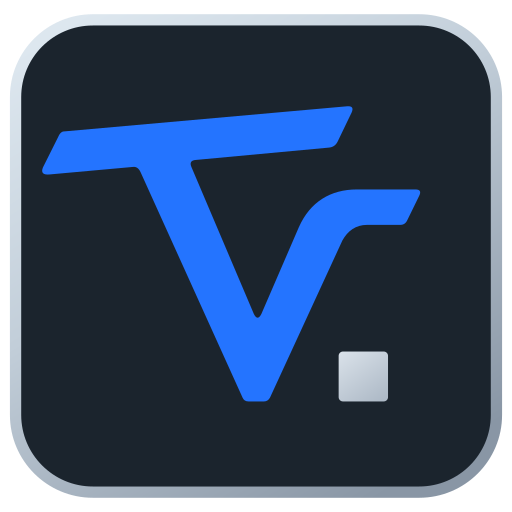

<p align="center">
  
</p>

<h1 align="center">Virgo Terminal</h1>

<p align="center">
  <a href="https://github.com/virgo-galaxy/virgo-terminal/actions/workflows/ci.yml"></a>
  <a href="https://www.npmjs.com/package/@virgo-terminal/react"></a>
  <a href="LICENSE"></a>
  <a href=".node-version"></a>
  <a href="package.json"></a>
</p>

<p align="center">
  <a href="README.md">English</a> | 简体中文
</p>

<p align="center">
  <a href="https://terminal.virgogalaxy.com/">体验 Playground</a>
</p>

Virgo Terminal 是用于交互终端和流式日志的 React 组件，支持显示 ANSI 输出。应用可以通过自己的连接层对接 Shell，转发终端输入和输出。终端基于 [xterm.js](https://xtermjs.org/)。

## 使用 React 组件

在 React 18.2 及以上的 18.x 版本或 React 19 应用中安装 `@virgo-terminal/react`。

```sh
npm install @virgo-terminal/react
```

下面的示例把收到的键盘输入写回终端。请给终端容器设置高度，`autoFit` 会根据容器尺寸调整行列数。

```tsx
import { useRef } from 'react';
import { Terminal, type TerminalHandle } from '@virgo-terminal/react';
import '@virgo-terminal/react/styles.css';

export function TerminalExample() {
  const terminal = useRef<TerminalHandle>(null);

  return (
    <Terminal
      ref={terminal}
      className="terminal-example"
      autoFit
      onReady={(instance) => instance.write('Hello, Virgo Terminal!\r\n')}
      onData={(data) => terminal.current?.write(data.replace(/\r\n|\r|\n/g, '\r\n'))}
    />
  );
}
```

```css
.terminal-example {
  height: 20rem;
}
```

### 常见接入方式

| 用途 | API |
| --- | --- |
| 显示只读日志 | 设置 `readOnly`，新日志到达时调用 `write()`，用 `scrollback` 限制保留的历史行数。 |
| 接入 Shell | 通过 `onData` 发送键盘输入，用 `onResize` 同步终端尺寸。收到 Shell 输出后调用 `write()`。 |
| 调整外观和输入 | 用 `appearance` 设置字体和颜色，用 `scrollbar` 调整滚动条，用 `copyOnSelect` 和 `shouldHandleKeyEvent` 控制交互。 |

## Playground

**Terminal** 和 **Simulated logs** 都有实时演示和中英文接入指南。

| 示例 | 可以体验什么 |
| --- | --- |
| Terminal | 在交互终端中输入并查看回显。 |
| Simulated logs | 在只读终端里查看带时间戳和 ANSI 颜色的流式日志。 |
| Connect device | 从线上 Playground 使用自己 Mac 或 Windows 电脑上的 Shell。下载客户端，选好 Shell 后在客户端点击「连接」。[打开连接本机](https://terminal.virgogalaxy.com/?view=connect-device) |
| Local Shell | 本地运行 Playground 时，通过 Vite 开发服务打开 Shell。设置抽屉会显示系统默认 Shell 和本机已安装的受支持选项。 |

## 开发

在仓库根目录使用 Node.js 24 和 pnpm 11.9.0。

```sh
pnpm install --frozen-lockfile
pnpm dev
```

打开 [localhost:3000](http://127.0.0.1:3000/)。运行 `pnpm check` 可以完成类型检查、Lint、测试和构建。

| 目录 | 内容 |
| --- | --- |
| [packages/react](packages/react) | React 组件、公开的 TypeScript API、样式及测试。 |
| [apps/playground](apps/playground) | Vite Playground、中英文接入指南和开发环境的 Shell 适配代码。 |
| [apps/local-client](apps/local-client) | 用 Go 编写的 macOS 和 Windows 客户端，用于「连接本机」。 |

## 参与贡献

请阅读[贡献指南](CONTRIBUTING.md)和[行为准则](CODE_OF_CONDUCT.md)。

## 许可证

[MIT](LICENSE)
